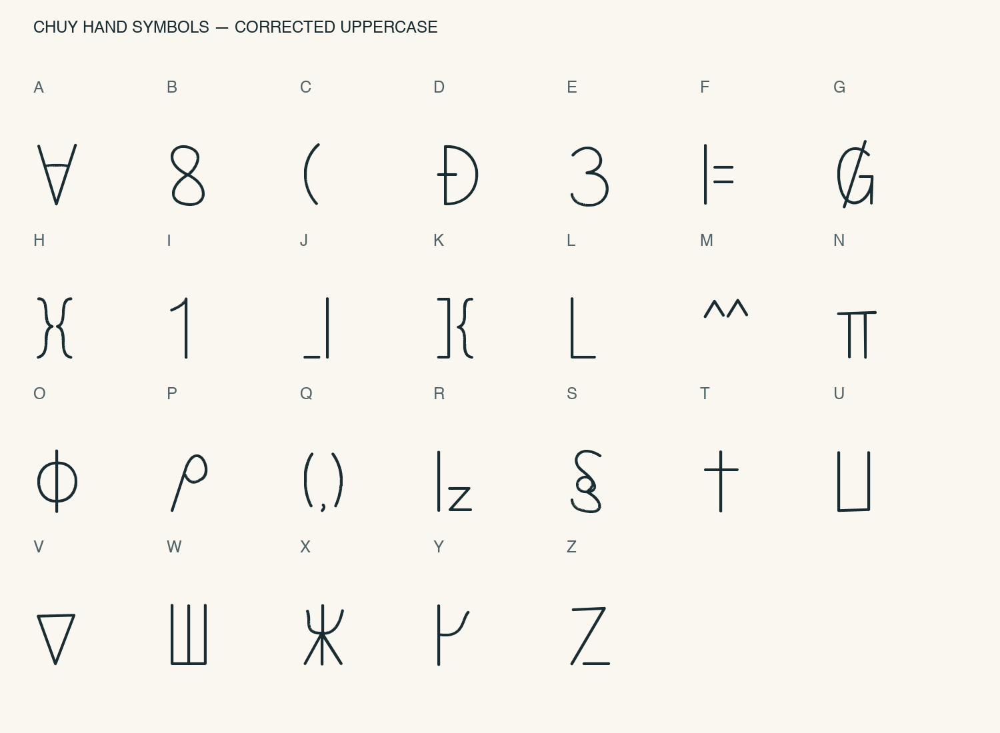

# Chuy Hand Symbols — v3

[English](README.md) | **Tiếng Việt**

Font nét viết tay với chữ hoa ký hiệu từ video, bộ ký hiệu thường a–z thu nhỏ từ chữ gốc và chữ tiếng Việt.

## Tải và cài đặt

[Tải font TTF](ChuyHandSymbols-Regular.ttf?raw=true), mở file rồi chọn **Install Font / Cài đặt**. Chọn **Chuy Hand Symbols** trong ứng dụng. Nếu đã cài v1, thay thế bằng bản v3.

## Hỗ trợ

- A–Z: ký hiệu dựng lại từ video tham chiếu.
- a–z: biến thể ký hiệu thu nhỏ, giữ cấu trúc nét của chữ hoa.
- Ă Â Ê Ô Ơ Ư Đ và ă â ê ô ơ ư đ.
- Đầy đủ dấu sắc, huyền, hỏi, ngã, nặng trên các nguyên âm tiếng Việt, cho cả chữ hoa và chữ thường.
- Ký tự tiếng Việt dựng sẵn Unicode và phép ghép dấu qua OpenType ccmp.
- Khoảng trắng. Chưa có số và dấu câu.

Chữ thường là biến thể thu nhỏ của ký hiệu gốc; dấu tiếng Việt được tự thiết kế vì video không có mẫu. Nét chữ hoa được dựng lại, không trích xuất nguyên bản từng pixel.

## Bảng chữ hoa đã sửa

## Đối chiếu bản gốc

Bản v3 sửa nét sai hoặc thiếu ở B, D, G, K, L, M, S, V, W, X. Chữ thường Latin ở v2 được thay bằng biến thể thu nhỏ của hệ ký hiệu gốc. Đây vẫn là bản dựng lại; khoảng cách và tỷ lệ có thể khác video.

