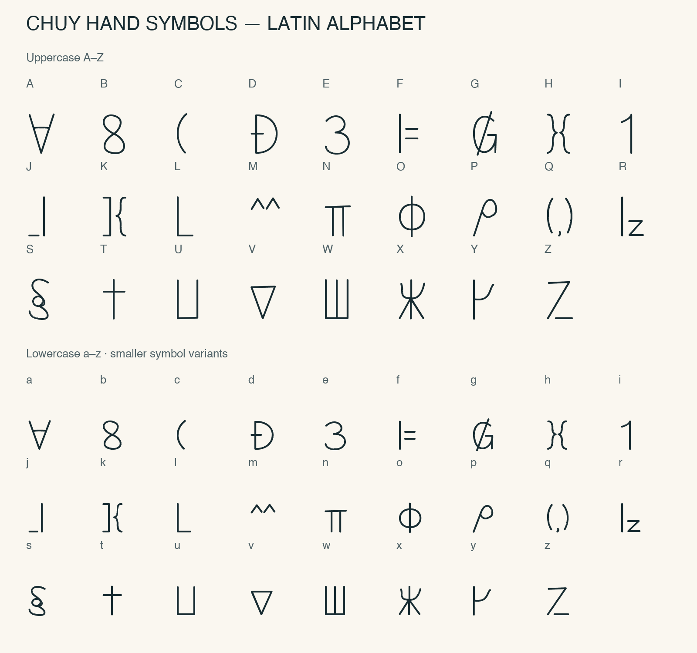
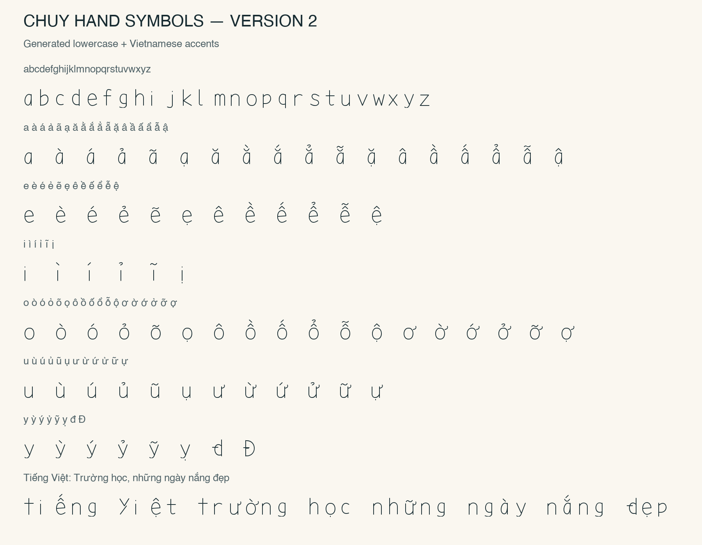
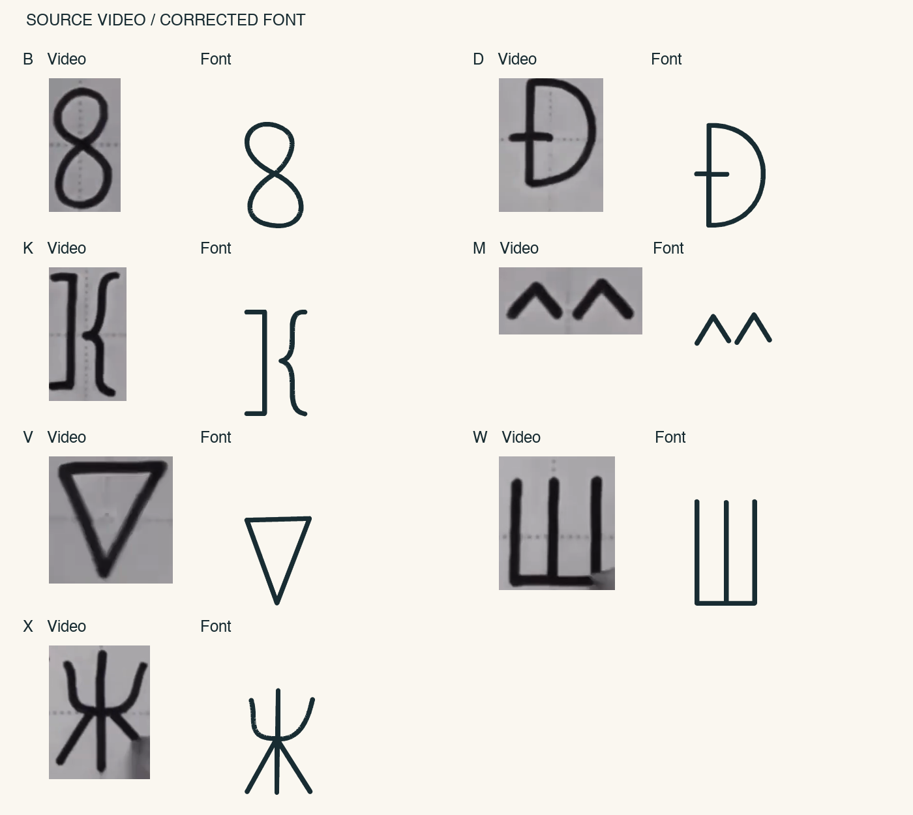

# Chuy Hand Symbols

[English](README.md) | **Tiếng Việt**

Font ký hiệu viết tay cho bảng chữ Latin. Gõ A–Z hoặc a–z để hiển thị ký hiệu tương ứng.

## Bảng chữ Latin

Chữ hoa được dựng lại từ video tham chiếu. Chữ thường là biến thể thu nhỏ, giữ hình dạng ký hiệu của chữ hoa.

## Tải và cài đặt

[Tải font TTF](ChuyHandSymbols-Regular.ttf?raw=true), mở file và chọn **Install Font / Cài đặt**. Chọn **Chuy Hand Symbols** trong ứng dụng. Nếu đã cài bản cũ, thay thế bằng v3.

Hỗ trợ A–Z, a–z và khoảng trắng. Chưa có số và dấu câu.

## Demo tiếng Việt

Phần mở rộng thử nghiệm bổ sung ă, â, ê, ô, ơ, ư, đ và năm dấu sắc, huyền, hỏi, ngã, nặng cho chữ hoa và chữ thường. Đây là phần tự thiết kế vì video không có mẫu tiếng Việt.

Bảng dưới dùng để xem thử hệ ký hiệu khi thêm dấu tiếng Việt.

## Đối chiếu bản gốc

Bản v3 sửa nét sai hoặc thiếu ở B, D, G, K, L, M, S, V, W, X. Chữ thường giữ cấu trúc ký hiệu gốc. Đây vẫn là bản dựng lại; tỷ lệ và khoảng cách có thể khác video.

